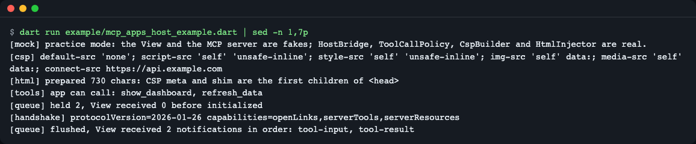
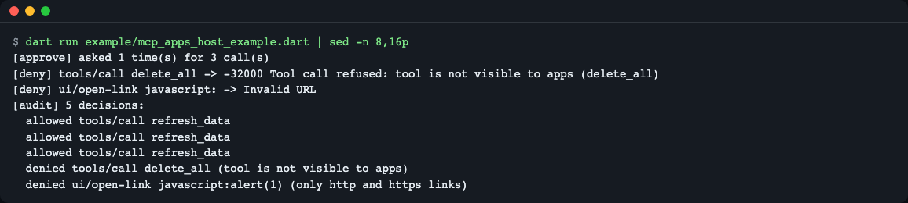
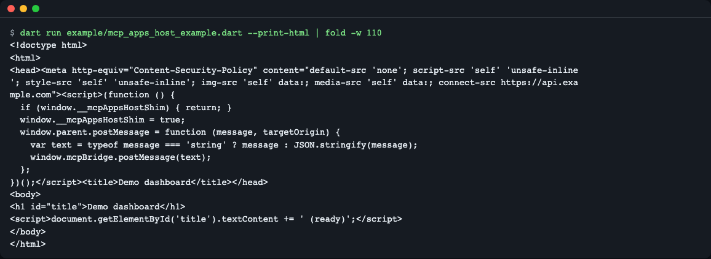
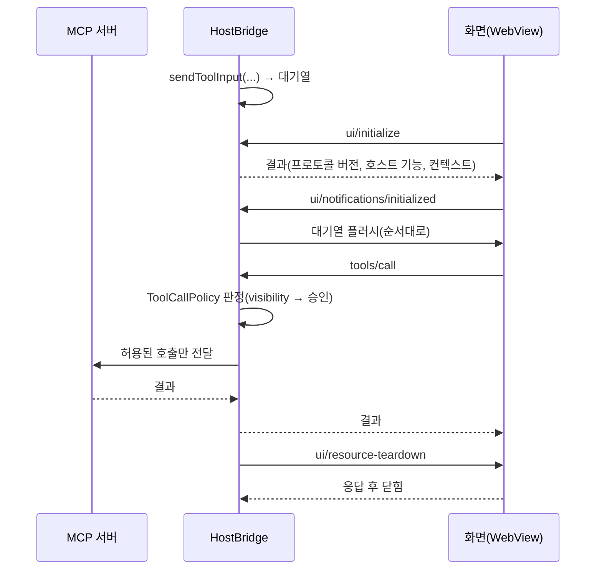
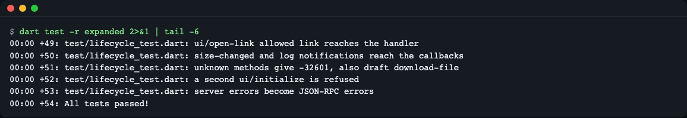

# mcp-apps-host-dart

[English](README.md) | **한국어**

MCP 서버의 도구가 내려 주는 작은 HTML 화면(MCP Apps, `ui://` 리소스)을 Flutter 앱의 WebView 안에 띄울 때 필요한 호스트 쪽 일(인사, 대기열, 도구 호출 권한, CSP)을 대신해 주는 Dart 패키지입니다. 상태: 0.1.1, 아직 pub.dev에 올리지 않았고 가짜 객체로만 검증했습니다(CI에 실제 WebView 없음, [한계](#한계) 참고). 설치는 아래의 git 방식을 쓰세요.



*연습용 목 모드의 앞부분. 화면이 준비되기 전 알림 2건이 대기열에 머물다가 준비 신호 뒤에 순서대로 도착합니다.*

## 이게 뭔가요

MCP 서버의 도구는 글자 대신 작은 HTML 화면을 돌려줄 수 있습니다. 이 화면을 내 앱의 WebView에 띄우려면 앱(호스트) 쪽이 해야 할 일이 많습니다. 화면과 인사(`ui/initialize`)를 나누고, 준비되기 전에는 아무것도 보내지 않고, 화면이 요청한 도구 호출을 걸러 내고, 접근 범위(CSP)를 조이는 일입니다.

비유하면 **유리 진열장과 관리인**입니다. 화면은 진열장 안의 물건이고 호스트는 관리인입니다. 물건이 직접 창고(도구)에 손대지 못하게 하고, 꼭 필요한 요청만 관리인이 확인한 뒤 대신 전달합니다. 이 라이브러리가 관리인 역할을 맡습니다.

공식 호스트 SDK(`@modelcontextprotocol/ext-apps`)는 TypeScript와 브라우저용입니다. Dart에는 화면(View) 쪽 패키지와 메타데이터 도우미(`mcp_dart`)만 있고 호스트 브리지는 없었습니다(2026-11-10 확인).

| 패키지 | 내용 |
|---|---|
| `packages/mcp_apps_host` | 순수 Dart. `HostBridge`, `ToolCallPolicy`, `CspBuilder`, `HtmlInjector`, `BridgeScripts`, 테스트 도우미 |
| `packages/mcp_apps_host_flutter` | `McpAppView` 위젯, `WebViewViewTransport`, `hostContextOf`, `showToolApprovalDialog` |

## 설치

아직 pub.dev에 올라가 있지 않아 git으로 설치합니다. 어댑터가 코어를 pub.dev 버전(`^0.1.0`)으로 요구하므로, git으로 쓰는 동안에는 `dependency_overrides`로 코어 출처를 같게 맞춰야 합니다.

```yaml
dependencies:
  mcp_apps_host:
    git: {url: https://github.com/LeeGyeongPil/mcp-apps-host-dart, path: packages/mcp_apps_host}
  mcp_apps_host_flutter:        # Flutter 앱일 때만
    git: {url: https://github.com/LeeGyeongPil/mcp-apps-host-dart, path: packages/mcp_apps_host_flutter}

dependency_overrides:           # pub.dev 게시 전까지만 필요
  mcp_apps_host:
    git: {url: https://github.com/LeeGyeongPil/mcp-apps-host-dart, path: packages/mcp_apps_host}
```

코어만 쓰면 `mcp_apps_host` 항목 하나로 충분하고 오버라이드는 필요 없습니다. 같은 구조(경로 의존 + 오버라이드)로 `flutter pub get`이 성공하는 것은 확인했지만, 이 레포가 공개되기 전이라 git 주소 형태는 직접 확인하지 못했습니다.

필요한 것: Dart 3.4 이상(코어), Flutter 3.32 이상과 Dart 3.8 이상(어댑터). 코어의 런타임 의존성은 `mcp_dart` 하나입니다. SDK 설치: https://docs.flutter.dev/get-started/install (Flutter에 Dart가 들어 있습니다).

## 빠르게 시작하기

가짜 서버·가짜 화면(`testing.dart`)으로 브리지를 직접 만져 봅니다. 파일은 [`packages/mcp_apps_host/example/quickstart.dart`](packages/mcp_apps_host/example/quickstart.dart)이고 그대로 실행됩니다.

```bash
cd packages/mcp_apps_host && dart pub get && dart run example/quickstart.dart
```

```dart
final pipe = MemoryPipe();
final bridge = HostBridge(
  transport: pipe.hostSide,
  server: FakeMcpServer(),
  hostInfo: const HostInfo(name: 'my-app', version: '1.0.0'),
  hostContext: const HostContext(theme: 'dark', platform: 'desktop'),
);
final view = ScriptedView(pipe.viewSide);
bridge.sendToolInput({'city': 'Seoul'}); // 화면이 준비될 때까지 대기열에 머묾
```

```text
queued before initialized: 1
View received: ui/notifications/tool-input
delete_all -> Tool call refused: tool is not visible to apps (delete_all)
```

(위 코드는 파일의 앞부분입니다. 나머지는 파일에 있습니다.) 마지막 줄은 모델 전용 도구 `delete_all`을 화면이 부르려 하자 서버에 닿기 전에 거부된 결과입니다.

## 5분 체험 (연습용 목 모드)

화면과 MCP 서버만 가짜(`ScriptedView`, `FakeMcpServer`)이고, 브리지·정책·CSP 코드는 실제 코드입니다. 키도 네트워크도 필요 없습니다. 실제 모드(실제 MCP 서버 연결)와 다른 점은 이 두 가짜뿐입니다.

```bash
cd packages/mcp_apps_host && dart pub get && dart run example/mcp_apps_host_example.dart
```

실제 출력(Dart 3.8.1):

```text
[mock] practice mode: the View and the MCP server are fakes; HostBridge, ToolCallPolicy, CspBuilder and HtmlInjector are real.
[csp] default-src 'none'; script-src 'self' 'unsafe-inline'; style-src 'self' 'unsafe-inline'; img-src 'self' data:; media-src 'self' data:; connect-src https://api.example.com
[html] prepared 730 chars: CSP meta and shim are the first children of <head>
[tools] app can call: show_dashboard, refresh_data
[queue] held 2, View received 0 before initialized
[handshake] protocolVersion=2026-01-26 capabilities=openLinks,serverTools,serverResources
[queue] flushed, View received 2 notifications in order: tool-input, tool-result
[approve] asked 1 time(s) for 3 call(s)
[deny] tools/call delete_all -> -32000 Tool call refused: tool is not visible to apps (delete_all)
[deny] ui/open-link javascript: -> Invalid URL
[audit] 5 decisions:
  allowed tools/call refresh_data
  allowed tools/call refresh_data
  allowed tools/call refresh_data
  denied tools/call delete_all (tool is not visible to apps)
  denied ui/open-link javascript:alert(1) (only http and https links)
[teardown] state=closed
```



*같은 출력의 뒷부분. 도구 3번 호출에 승인 1번, 모델 전용 도구와 `javascript:` 링크는 거부, 5건의 판정이 감사 로그에 남습니다.*

읽는 법:

- `held 2` → 화면이 준비되기 전 호스트가 보낸 알림 2건은 대기열에 머물고, 준비 신호(`initialized`) 뒤에 순서대로 도착합니다.
- `asked 1 time(s) for 3 call(s)` → 같은 도구를 3번 불러도 사용자에게는 1번만 묻습니다(`perToolPerSession`).
- `delete_all` 거부 → 모델 전용 도구는 서버에 닿기 전에 거부됩니다.
- `[csp]` → 스펙 기본 CSP. 서버가 선언한 도메인(`connect-src`)만 더해집니다.

`--print-html`을 붙이면 CSP와 브리지 스크립트가 `<head>` 맨 앞에 들어간 HTML만 출력합니다.

```bash
dart run example/mcp_apps_host_example.dart --print-html
```



*CSP `<meta>`와 브리지 스크립트가 화면 문서의 스크립트보다 앞에 놓입니다. 그래야 화면 스크립트가 실행되기 전에 제한이 걸립니다.*

## 핵심 개념

1. **ViewTransport**: 화면과 주고받는 문자열 통로(`Stream<String> incoming`, `void send(String)`). WebView 종류를 이 인터페이스 뒤로 숨겨, 코어는 WebView 없이 테스트됩니다.
2. **HostBridge**: 한 화면을 담당하는 관리인. 인사에 답하고, 준비 전 알림을 대기열에 쌓고, 도구 호출을 정책에 물어본 뒤 서버에 전달합니다.
3. **ToolCallPolicy**: 도구 호출 판정. 두 층입니다. (1) 도구의 `visibility`에 `app`이 없으면 무조건 거부(스펙의 MUST), (2) 그 위에 사용자 승인(선택). 승인 모드인데 승인 함수가 없으면 만들 때 오류를 냅니다(fail closed).
4. **CSP**: 화면이 닿을 수 있는 곳의 제한. 기본값에서 더 조일 수는 있어도 풀지는 않습니다.

## 동작 흐름



그림 풀이: 호스트는 인사 전에 쌓아 두고, 화면이 준비되면 쏟아내며, 화면의 도구 요청은 정책을 통과한 것만 서버로 갑니다. 마지막에 호스트가 정리 요청을 보내고 화면의 응답을 기다립니다.

호스트가 다루는 메서드(이름은 `UiMethods`에 있고 `UiMethods.all`이 17개입니다):

| 방향 | 메서드 | 처리 |
|---|---|---|
| 화면 → 호스트 | `ui/initialize` | 프로토콜 버전·호스트 기능·컨텍스트로 응답 |
| 화면 → 호스트 | `tools/call`, `resources/read` | 정책 통과 후 서버에 전달 / 서버에서 읽기 |
| 화면 → 호스트 | `ui/open-link`, `ui/message`, `ui/request-display-mode`, `ui/update-model-context` | 앱이 준 핸들러가 있을 때만 광고·처리, 없으면 `-32601` |
| 화면 → 호스트 | `ui/notifications/initialized`, `size-changed` | 대기열 플러시 / 높이 콜백 |
| 호스트 → 화면 | `tool-input`, `tool-input-partial`, `tool-result`, `tool-cancelled`, `host-context-changed` | 준비 전에는 대기열(상한 256, 넘으면 오래된 것부터 버리고 감사 기록) |
| 호스트 → 화면 | `ui/resource-teardown` | 응답을 기다린 뒤 닫음 |
| 초안·프록시용 | `ui/download-file`, `ui/notifications/request-teardown`, `sandbox-proxy-ready`, `sandbox-resource-ready` | 지원하지 않음 |

## API

코어 `package:mcp_apps_host/mcp_apps_host.dart`:

| 이름 | 하는 일 | 주요 인자 | 반환 |
|---|---|---|---|
| `HostBridge` | 화면 하나의 호스트 쪽 | `transport`, `server`, `hostInfo`, `hostContext`, `policy`, `onOpenLink`·`onMessage`·`onRequestDisplayMode`·`onUpdateModelContext`·`onSizeChanged`·`onLog`, `maxQueued`(256), `maxAuditEntries`(1000) | 인스턴스. `state`, `stateChanges`, `audit`, `queuedCount`, `hostCapabilities` |
| `HostBridge.sendToolInput` / `sendToolInputPartial` / `sendToolResult` / `sendToolCancelled` | 화면에 알림 보내기(준비 전이면 대기열) | 인자 맵 / 결과 맵 / 이유 | `void`. 닫힌 뒤에는 `BridgeClosedException` |
| `HostBridge.updateHostContext` | 테마·크기 등 컨텍스트 변경 알림 | 바뀐 항목 맵 | `void` |
| `HostBridge.teardown` / `close` | 정리 요청 후 응답 대기 / 즉시 닫기 | `reason`, `timeout` | `Future<void>` |
| `ToolCallPolicy` | 도구 호출 판정 | `mode`(`ApprovalMode`), `approver`, `allow`, `deny` | `evaluate(...)` → `PolicyVerdict`, `resetSession()` |
| `ApprovalMode` | 승인 방식 | `never`, `perCall`, `perToolPerSession`, `perSession` | enum |
| `ToolApprovalRequest`, `ToolApprover` | 승인 요청(도구 이름·인자)과 승인 함수 | | `Future<bool>` |
| `CspBuilder.build` / `isValidDomain` | 스펙 기본 CSP 문자열 만들기 / 선언 도메인 검사 | `UiCsp?` | `String` / `bool` |
| `HtmlInjector.prepare` | `<head>` 맨 앞에 CSP meta와 shim 삽입 | `html`, `csp`, `shim` | `String` |
| `BridgeScripts.shim` / `dispatch` | WebView용 `postMessage` shim / 호스트→화면 전달 스크립트 | `channel`(기본 `mcpBridge`) / JSON 문자열 | `String`(JS) |
| `ViewTransport` | 화면과의 통로 인터페이스 | | `incoming`, `send` |
| `McpServerAdapter` | 서버 연결 인터페이스 | | `listTools`, `callTool`, `readResource` |
| `McpAppsRpcException` | 화면에 JSON-RPC 오류로 전달되는 예외 | `code`, `message` | |
| `UiToolMeta`, `UiResourceMeta` | `_meta.ui`(옛 키 `ui/resourceUri` 포함) 읽기 | 도구 / 리소스 맵 | `resourceUri`, `visibleToApp`, `csp` 등 |
| `HostInfo`, `HostContext`, `UiCsp`, `ViewSize`, `AuditEntry`, `LogEntry` | 값 타입 | | |

`package:mcp_apps_host/mcp_dart.dart`의 `McpDartServerAdapter(client)`는 `mcp_dart` 클라이언트를 `McpServerAdapter`로 감쌉니다. `package:mcp_apps_host/testing.dart`는 `MemoryPipe`, `ScriptedView`, `FakeMcpServer`를 줍니다.

Flutter 어댑터 `package:mcp_apps_host_flutter/mcp_apps_host_flutter.dart`:

| 이름 | 하는 일 | 주요 인자 | 반환 |
|---|---|---|---|
| `McpAppView` | WebView 위젯. 브리지·CSP·이동 잠금을 묶음 | `server`, `html`, `hostInfo`, `csp`, `policy`, 핸들러들, `onBridgeReady`, `initialHeight`(300), `maxHeight`(800), `baseUrl`, `controller` | 위젯 |
| `WebViewViewTransport` | `webview_flutter`용 `ViewTransport` | `controller`, `channel` | 인스턴스 |
| `hostContextOf` | 테마·플랫폼·안전 영역·언어를 `MediaQuery`에서 읽어 `HostContext` 생성 | `BuildContext`, `maxHeight` | `HostContext` |
| `showToolApprovalDialog` / `ToolApprovalDialog` | 기본 승인 대화상자(도구 이름·인자) | `BuildContext`, `ToolApprovalRequest` | `Future<bool>` |

## 사용 예

### 1. Flutter 앱에 붙이기

```dart
McpAppView(
  server: serverAdapter,   // McpServerAdapter. mcp_dart 클라이언트는 McpDartServerAdapter(client)
  html: resourceText,      // ui:// 리소스의 HTML 텍스트
  csp: resourceMeta.csp,   // _meta.ui.csp 선언(없으면 null)
  hostInfo: const HostInfo(name: 'my-app', version: '1.0.0'),
  policy: ToolCallPolicy(
    mode: ApprovalMode.perToolPerSession,
    approver: (r) => showToolApprovalDialog(context, r),
  ),
  onOpenLink: (url) async => openInBrowser(url),
  onBridgeReady: (bridge) => bridge.sendToolInput(args), // 준비 전이면 대기열에 쌓입니다
)
```

(이 조각은 위젯 테스트 `mcp_app_view_test.dart`가 같은 방식으로 실행합니다. 실제 WebView에서의 렌더링은 확인하지 않았습니다. [한계](#한계) 참고.)

승인 모드: `never`(묻지 않음, 목록·visibility는 계속 적용), `perCall`(매번), `perToolPerSession`(도구마다 한 번), `perSession`(한 번). visibility 검사는 스펙의 MUST라 항상 적용되고, 사용자 승인은 그 위에 얹는 선택 층입니다. 동시에 도착한 호출은 질문 하나를 공유하고, 승인만 기억합니다. 거부는 기억하지 않아 다음 호출에서 다시 묻습니다.

화면을 떼기 전에는 `onBridgeReady`로 받은 `bridge.teardown`을 먼저 부르고, html·server·csp·policy를 바꾸려면 새 `key`를 주세요.

#### 예제 앱 실행

`packages/mcp_apps_host_flutter/example/`에 예제 앱이 있습니다. 플랫폼 폴더를 만든 뒤 실행합니다.

```bash
cd packages/mcp_apps_host_flutter/example && flutter create --platforms=macos,ios,android .
flutter run -d macos
```

- `flutter create`가 만드는 기본 `test/widget_test.dart`는 이 예제와 맞지 않아 `flutter analyze`가 오류를 냅니다. 지우고(`rm test/widget_test.dart`) 쓰세요.
- 그래도 `flutter analyze`가 경고 1건(`include_file_not_found`)을 냅니다. 생성된 `analysis_options.yaml`이 `flutter_lints`를 include 하는데 예제는 그 패키지에 의존하지 않기 때문이며 `flutter run`에는 영향이 없습니다. 그 파일의 `include:` 줄을 지우면 사라집니다.
- macOS에서 실행하려면 Xcode와 CocoaPods가 설치돼 있어야 합니다(`brew install cocoapods`).

실기기·실제 WebView에서는 확인하지 못했습니다([한계](#한계)).

### 2. 다른 WebView 패키지와 쓰기

`mcp_apps_host`만 의존하고 `ViewTransport`(`Stream<String> incoming`, `void send(String)`)를 직접 구현합니다. `BridgeScripts.shim()`과 `HtmlInjector.prepare(...)`로 HTML을 준비하고, 받은 메시지는 `BridgeScripts.dispatch(json)`으로 화면에 전달합니다. 테스트에서는 `package:mcp_apps_host/testing.dart`의 `MemoryPipe`, `ScriptedView`, `FakeMcpServer`를 씁니다. 위 "빠르게 시작하기"가 그 구성입니다.

### 3. 실제 서버에 붙여 보기 (선택)

로컬에서 MCP 서버를 띄운 뒤 `<port>`를 채워 실행합니다.

```bash
dart run example/mcp_apps_host_example.dart --server http://localhost:<port>/mcp
```

앱 도구 목록, 리소스 선언으로 만든 CSP를 보여 주고 대본 화면으로 도구 하나를 위임 호출합니다. 연결에 실패하면 종료 코드 2입니다. **이 경로는 자동 테스트에 없고, 이 레포 작성 시점에 실제 서버로 확인하지 못했습니다.** 실제 서버는 네트워크·응답 속도 등 환경에 따라 느리거나 달라질 수 있습니다.

## WebView 호스트 함정과 대응

예를 들어 WebView 최상위에서는 `window.parent === window`라서, 메시지에 `event.source`를 넣지 않으면 화면 쪽 SDK가 그 메시지를 버립니다. 이런 함정 8가지와 대응하는 테스트 이름이 [docs/pitfalls.md](docs/pitfalls.md)에 표로 있습니다(자기 메아리, `initialized` 전 송신 금지, sandbox 속성 없음·`<meta>` CSP 한계, 옛 메타 키, 앱 전용 도구 노출, 승인 카드 폭증, CSP 도메인 끼워넣기).

## 언제 쓰나

- 이럴 때: Flutter(모바일·데스크톱) MCP 클라이언트에서 `ui://` 화면을 띄워야 하고, 핸드셰이크·권한·CSP를 직접 짜고 싶지 않을 때. WebView 패키지를 다른 것으로 쓰면 코어(`mcp_apps_host`)만 가져가 `ViewTransport`를 구현합니다.
- 이럴 땐 다른 도구: 브라우저(웹) 호스트 → 공식 [`@modelcontextprotocol/ext-apps`](https://github.com/modelcontextprotocol/ext-apps)의 호스트 쪽 도우미, `ui://` 화면(View) 만들기 → 같은 저장소의 View 쪽 SDK.

## 한계

- **실제 WebView 렌더링은 CI에서 검증하지 않습니다.** 가짜 `WebViewPlatform`으로 하는 위젯 테스트까지입니다. 수동 점검표: [docs/manual-check.md](docs/manual-check.md). 위의 `McpAppView` 사용 예와 어댑터의 화면 동작(높이 조절, 링크 차단 등)은 실기기에서 확인되지 않았습니다.
- **`--server` 실제 모드는 자동 테스트에도, 이 레포 작성 시점의 수동 확인에도 없습니다.**
- WebView에는 iframe `sandbox`와 불투명 origin이 없어 브라우저 호스트보다 격리가 약합니다. `<meta>` CSP는 `frame-ancestors`, `sandbox`를 지원하지 않습니다. 이 라이브러리는 "스펙이 요구하는 최소 정책을 적용"할 뿐 "안전하다"고 보장하지 않습니다.
- 초안 메서드(`ui/download-file`, `request-teardown`)는 지원하지 않습니다(`-32601` 또는 감사 로그만).
- Windows, Linux, Flutter 웹은 지원하지 않습니다. 웹 호스트용 이중 iframe 프록시도 없습니다.
- 승인 대기(`approver` 질문이 떠 있는) 상태의 경계 사례 세 가지는 알려진 한계입니다. (1) `approver` 콜백이 동기 예외를 던지면 그 호출의 대기 항목이 내부 대기 맵에 남을 수 있습니다. (2) 승인을 기다리는 중 `resetSession`을 부르면 대기 중인 질문 결과가 새 세션에 어떻게 반영되는지 정의가 느슨합니다. (3) 승인을 기다리는 중 `teardown`이 끝난 뒤 사용자가 허용하면 `callTool`이 그대로 실행될 수 있습니다. 앱 쪽에서는 화면을 떼기 전에 승인 창을 닫고, `approver`는 예외를 던지지 않게 감싸 두세요.
- 확인한 버전: Dart 3.8.1, Flutter 3.32.4, webview_flutter 4.13.1, mcp_dart 2.4.3 (webview_flutter 4.14.x는 Flutter 3.38 이상이 필요합니다).

## 버전·호환성

- 유의적 버전(SemVer)을 따릅니다. 0.x 동안은 마이너 버전에서 API가 바뀔 수 있고, 바뀌면 각 패키지의 `CHANGELOG.md`([코어](packages/mcp_apps_host/CHANGELOG.md), [어댑터](packages/mcp_apps_host_flutter/CHANGELOG.md))에 적습니다.
- 구현 기준: MCP Apps 스펙 2026-01-26.

## 개발·기여

```bash
sh tool/test_all.sh
```

두 패키지의 `pub get`, 분석, 테스트를 순서대로 돌립니다(코어 54개, 어댑터 8개). 필요한 것은 Dart/Flutter SDK와 `pub get`용 네트워크입니다. 테스트 자체는 키·네트워크가 필요 없습니다.



*코어 테스트 요약. WebView 없이 핸드셰이크·대기열·정책·CSP가 검증됩니다.*

이슈는 GitHub Issues로 받습니다. 보안 문제는 [SECURITY.md](SECURITY.md)를 따릅니다.

## 더 알아보기

- MCP Apps 스펙과 SDK: https://github.com/modelcontextprotocol/ext-apps (2026-11-10 확인)
- `webview_flutter`: https://pub.dev/packages/webview_flutter
- `mcp_dart`: https://pub.dev/packages/mcp_dart

## 라이선스

MIT. 메서드 이름 17개 목록은 `@modelcontextprotocol/ext-apps` 2.0.4의 `schema.json`에서 사실만 옮긴 것이며(코드 복사 없음), 스펙은 위 저장소(2026-11-10 확인)를 따릅니다.
