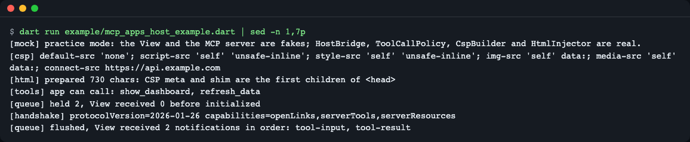
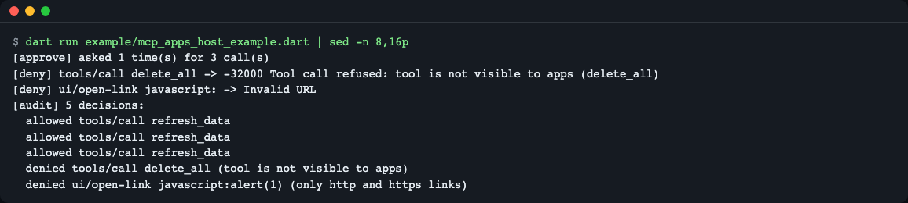
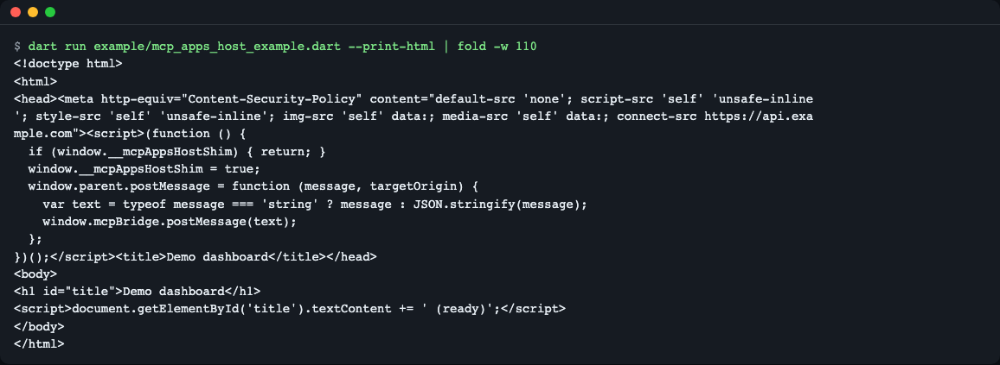
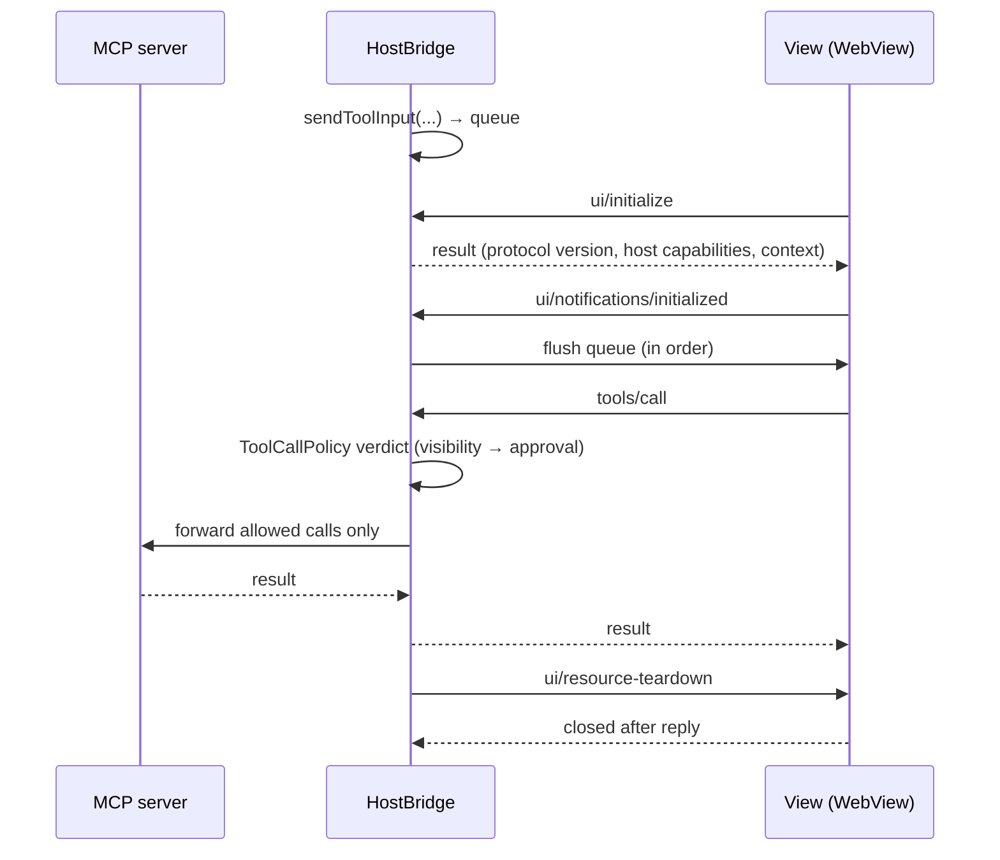
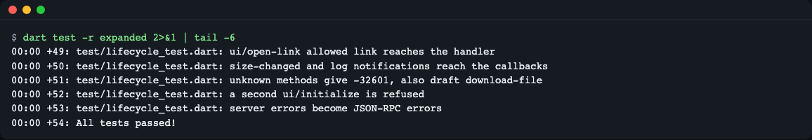

# mcp-apps-host-dart

**English** | [한국어](README.ko.md)

Host-side bridge for MCP Apps (`ui://` interactive views) in Dart and Flutter. When a tool on an MCP server returns a small HTML view, your app (the host) has to do the work around it: the handshake, a queue, tool-call permissions and CSP. These packages do that work for you. `mcp_apps_host` is pure Dart (handshake, queue until `initialized`, tool-call permission policy, spec default CSP, WebView `postMessage` shims). `mcp_apps_host_flutter` is a thin `webview_flutter` widget, `McpAppView`. The official host SDK is TypeScript-only, so this fills the Dart/Flutter gap. Status: 0.2.0, not on pub.dev yet, verified with fakes only (no real WebView in CI, see [Limits](#limits)). Install from git, see below.



*The first part of the practice mock mode. Two notifications wait in the queue until the view is ready, then arrive in order after the ready signal.*

## What is this

A tool on an MCP server can return a small HTML view instead of text. To show that view in your app's WebView, the app (the host) has a lot to do. It must separate the view from the handshake (`ui/initialize`), send nothing until the view is ready, filter the tool calls the view asks for, and tighten the access scope (CSP).

Think of a **glass display case and an attendant**. The view is the item in the case and the host is the attendant. The item cannot touch the warehouse (the tools) directly. The attendant checks each request and passes on only the ones that are needed. This library plays the attendant.

The official host SDK (`@modelcontextprotocol/ext-apps`) is for TypeScript and browsers. For Dart there were only a view-side package and a metadata helper (`mcp_dart`), and no host bridge (checked 2026-11-10).

| Package | Contents |
|---|---|
| `packages/mcp_apps_host` | Pure Dart. `HostBridge`, `ToolCallPolicy`, `CspBuilder`, `HtmlInjector`, `BridgeScripts`, test helpers |
| `packages/mcp_apps_host_flutter` | `McpAppView` widget, `WebViewViewTransport`, `hostContextOf`, `showToolApprovalDialog` |

## Install

It is not on pub.dev yet, so install it from git. The adapter requires the core at the pub.dev version (`^0.2.0`), so while you use git you must point the core at the same source with `dependency_overrides`.

```yaml
dependencies:
  mcp_apps_host:
    git: {url: https://github.com/LeeGyeongPil/mcp-apps-host-dart, path: packages/mcp_apps_host}
  mcp_apps_host_flutter:        # only for Flutter apps
    git: {url: https://github.com/LeeGyeongPil/mcp-apps-host-dart, path: packages/mcp_apps_host_flutter}

dependency_overrides:           # only needed until it is published to pub.dev
  mcp_apps_host:
    git: {url: https://github.com/LeeGyeongPil/mcp-apps-host-dart, path: packages/mcp_apps_host}
```

If you only use the core, the single `mcp_apps_host` entry is enough and no override is needed. `flutter pub get` succeeds with the same structure (path dependency plus override). The git URL form could not be checked directly because this repo was not public yet.

Requirements: Dart 3.4 or newer (core), Flutter 3.32 or newer and Dart 3.8 or newer (adapter). The core's only runtime dependency is `mcp_dart`. SDK install: https://docs.flutter.dev/get-started/install (Flutter includes Dart).

## Quick start

Play with the bridge directly using a fake server and a fake view (`testing.dart`). The file is [`packages/mcp_apps_host/example/quickstart.dart`](packages/mcp_apps_host/example/quickstart.dart) and it runs as is.

```bash
cd packages/mcp_apps_host && dart pub get && dart run example/quickstart.dart
```

```dart
final pipe = MemoryPipe();
final bridge = HostBridge(
  transport: pipe.hostSide,
  server: FakeMcpServer(),
  hostInfo: const HostInfo(name: 'my-app', version: '1.0.0'),
  hostContext: const HostContext(theme: 'dark', platform: 'desktop'),
);
final view = ScriptedView(pipe.viewSide);
bridge.sendToolInput({'city': 'Seoul'}); // stays in the queue until the view is ready
```

```text
queued before initialized: 1
View received: ui/notifications/tool-input
delete_all -> Tool call refused: tool is not visible to apps (delete_all)
```

(The code above is the first part of the file. The rest is in the file.) The last line shows the result when the view tried to call the model-only tool `delete_all`: it was refused before it reached the server.

## Five-minute trial (practice mock mode)

Only the view and the MCP server are fake (`ScriptedView`, `FakeMcpServer`). The bridge, policy and CSP code are real. No key or network is needed. These two fakes are the only difference from real mode (connecting to a real MCP server).

```bash
cd packages/mcp_apps_host && dart pub get && dart run example/mcp_apps_host_example.dart
```

Real output (Dart 3.8.1):

```text
[mock] practice mode: the View and the MCP server are fakes; HostBridge, ToolCallPolicy, CspBuilder and HtmlInjector are real.
[csp] default-src 'none'; script-src 'self' 'unsafe-inline'; style-src 'self' 'unsafe-inline'; img-src 'self' data:; media-src 'self' data:; connect-src https://api.example.com
[html] prepared 730 chars: CSP meta and shim are the first children of <head>
[tools] app can call: show_dashboard, refresh_data
[queue] held 2, View received 0 before initialized
[handshake] protocolVersion=2026-01-26 capabilities=openLinks,serverTools,serverResources
[queue] flushed, View received 2 notifications in order: tool-input, tool-result
[approve] asked 1 time(s) for 3 call(s)
[deny] tools/call delete_all -> -32000 Tool call refused: tool is not visible to apps (delete_all)
[deny] ui/open-link javascript: -> Invalid URL
[audit] 5 decisions:
  allowed tools/call refresh_data
  allowed tools/call refresh_data
  allowed tools/call refresh_data
  denied tools/call delete_all (tool is not visible to apps)
  denied ui/open-link javascript:alert(1) (only http and https links)
[teardown] state=closed
```



*The second part of the same output. Three tool calls cost one approval, the model-only tool and the `javascript:` link are refused, and five decisions land in the audit log.*

How to read it:

- `held 2` → the two notifications the host sent before the view was ready wait in the queue and arrive in order after the ready signal (`initialized`).
- `asked 1 time(s) for 3 call(s)` → calling the same tool three times asks the user only once (`perToolPerSession`).
- `delete_all` refused → a model-only tool is refused before it reaches the server.
- `[csp]` → the spec default CSP. Only the domains the server declared (`connect-src`) are added.

Add `--print-html` to print only the HTML, with the CSP and the bridge script placed at the very start of `<head>`.

```bash
dart run example/mcp_apps_host_example.dart --print-html
```



*The CSP `<meta>` and the bridge script come before the view document's own scripts. That way the restrictions apply before the view's scripts run.*

## Core concepts

1. **ViewTransport**: the string channel to and from the view (`Stream<String> incoming`, `void send(String)`). It hides the WebView type behind this interface, so the core is tested without a WebView.
2. **HostBridge**: the attendant for one view. It answers the handshake, queues notifications that arrive before the view is ready, asks the policy about each tool call, then forwards allowed ones to the server.
3. **ToolCallPolicy**: the verdict on tool calls, in two layers. (1) If the tool's `visibility` does not include `app`, the call is always refused (a MUST in the spec). (2) On top of that, user approval (optional). If the mode needs approval but no approver function is given, construction throws an error (fail closed).
4. **CSP**: the limit on where the view can reach. You can tighten the default but never loosen it.

## Flow



Reading the diagram: the host holds notifications until the handshake, releases them when the view is ready, and only tool requests that pass the policy go on to the server. At the end the host sends a teardown request and waits for the view's reply.

The methods the host handles (the names are in `UiMethods`, and `UiMethods.all` has 17):

| Direction | Method | Handling |
|---|---|---|
| View → host | `ui/initialize` | Reply with protocol version, host capabilities and context |
| View → host | `tools/call`, `resources/read` | Forward to the server after the policy / read from the server |
| View → host | `ui/open-link`, `ui/message`, `ui/request-display-mode`, `ui/update-model-context` | Advertised and handled only when the app gave a handler, otherwise `-32601` |
| View → host | `ui/notifications/initialized`, `size-changed` | Flush the queue / height callback |
| Host → view | `tool-input`, `tool-input-partial`, `tool-result`, `tool-cancelled`, `host-context-changed` | Queued until ready (limit 256; when full, the oldest are dropped and recorded in the audit) |
| Host → view | `ui/resource-teardown` | Wait for the reply, then close |
| Draft / proxy only | `ui/download-file`, `ui/notifications/request-teardown`, `sandbox-proxy-ready`, `sandbox-resource-ready` | Not supported |

## API

Core `package:mcp_apps_host/mcp_apps_host.dart`:

| Name | What it does | Main arguments | Returns |
|---|---|---|---|
| `HostBridge` | The host side of one view | `transport`, `server`, `hostInfo`, `hostContext`, `policy`, `onOpenLink`, `onMessage`, `onRequestDisplayMode`, `onUpdateModelContext`, `onSizeChanged`, `onLog`, `maxQueued` (256), `maxAuditEntries` (1000) | Instance. `state`, `stateChanges`, `audit`, `queuedCount`, `hostCapabilities` |
| `HostBridge.sendToolInput` / `sendToolInputPartial` / `sendToolResult` / `sendToolCancelled` | Send a notification to the view (queued if not ready) | Argument map / result map / reason | `void`. `BridgeClosedException` after close |
| `HostBridge.updateHostContext` | Notify of a context change such as theme or size | Map of changed items | `void` |
| `HostBridge.teardown` / `close` | Request teardown and wait for the reply / close at once | `reason`, `timeout` | `Future<void>` |
| `ToolCallPolicy` | Verdict on a tool call | `mode` (`ApprovalMode`), `approver`, `allow`, `deny` | `evaluate(...)` → `PolicyVerdict`, `resetSession()` |
| `ApprovalMode` | Approval style | `never`, `perCall`, `perToolPerSession`, `perSession` | enum |
| `ToolApprovalRequest`, `ToolApprover` | The approval request (tool name, arguments) and the approver function | | `Future<bool>` |
| `CspBuilder.build` / `isValidDomain` | Build the spec default CSP string / check a declared domain | `UiCsp?` | `String` / `bool` |
| `HtmlInjector.prepare` | Insert the CSP meta and shim at the very start of `<head>` | `html`, `csp`, `shim` | `String` |
| `BridgeScripts.shim` / `dispatch` | `postMessage` shim for the WebView / script that delivers host → view messages | `channel` (default `mcpBridge`) / JSON string | `String` (JS) |
| `ViewTransport` | Interface for the channel to the view | | `incoming`, `send` |
| `McpServerAdapter` | Interface for the server connection | | `listTools`, `callTool`, `readResource` |
| `McpAppsRpcException` | Exception passed to the view as a JSON-RPC error | `code`, `message` | |
| `UiToolMeta`, `UiResourceMeta` | Read `_meta.ui` (including the old key `ui/resourceUri`) | Tool / resource map | `resourceUri`, `visibleToApp`, `csp`, etc. |
| `HostInfo`, `HostContext`, `UiCsp`, `ViewSize`, `AuditEntry`, `LogEntry` | Value types | | |

`McpDartServerAdapter(client)` in `package:mcp_apps_host/mcp_dart.dart` wraps an `mcp_dart` client as an `McpServerAdapter`. `package:mcp_apps_host/testing.dart` gives you `MemoryPipe`, `ScriptedView` and `FakeMcpServer`.

Flutter adapter `package:mcp_apps_host_flutter/mcp_apps_host_flutter.dart`:

| Name | What it does | Main arguments | Returns |
|---|---|---|---|
| `McpAppView` | WebView widget. Ties together the bridge, CSP and navigation lock | `server`, `html`, `hostInfo`, `csp`, `policy`, handlers, `onBridgeReady`, `initialHeight` (300), `maxHeight` (800), `baseUrl`, `controller` | Widget |
| `WebViewViewTransport` | `ViewTransport` for `webview_flutter` | `controller`, `channel` | Instance |
| `hostContextOf` | Build a `HostContext` from `MediaQuery` (theme, platform, safe area, locale) | `BuildContext`, `maxHeight` | `HostContext` |
| `showToolApprovalDialog` / `ToolApprovalDialog` | Default approval dialog (tool name, arguments; English or Korean texts) | `BuildContext`, `ToolApprovalRequest`, optional `labels`, `locale` | `Future<bool>` |

## Usage examples

### 1. Add it to a Flutter app

```dart
McpAppView(
  server: serverAdapter,   // McpServerAdapter. For an mcp_dart client use McpDartServerAdapter(client)
  html: resourceText,      // HTML text of the ui:// resource
  csp: resourceMeta.csp,   // the _meta.ui.csp declaration (null if none)
  hostInfo: const HostInfo(name: 'my-app', version: '1.0.0'),
  policy: ToolCallPolicy(
    mode: ApprovalMode.perToolPerSession,
    approver: (r) => showToolApprovalDialog(context, r),
  ),
  onOpenLink: (url) async => openInBrowser(url),
  onBridgeReady: (bridge) => bridge.sendToolInput(args), // queued if the view is not ready yet
)
```

(The widget test `mcp_app_view_test.dart` runs this snippet in the same way. Rendering in a real WebView has not been checked. See [Limits](#limits).)

Approval modes: `never` (never ask; the list and visibility still apply), `perCall` (every call), `perToolPerSession` (once per tool), `perSession` (once). The visibility check is a MUST in the spec, so it always applies, and user approval is an optional layer on top. Calls that arrive at the same time share one question, and only approvals are remembered. Refusals are not remembered, so the next call asks again.

Approval dialog language: the default dialog follows the app locale (Korean when it is `ko`, otherwise English). Pass `locale: 'ko-KR'` or your own `labels: ToolApprovalLabels(title: ..., allow: ..., deny: ...)` to choose it yourself; `labels` wins over `locale`. For auto-detection to give Korean, the app must list `ko` in `supportedLocales` and have a `flutter_localizations` delegate; otherwise the dialog stays English (or set `locale`/`labels` yourself).

```dart
showToolApprovalDialog(context, request, locale: 'ko');
```

Before you remove the view, call `bridge.teardown` (received through `onBridgeReady`) first. To change html, server, csp or policy, give it a new `key`.

#### Run the example app

There is an example app in `packages/mcp_apps_host_flutter/example/`. Create the platform folders, then run it.

```bash
cd packages/mcp_apps_host_flutter/example && flutter create --platforms=macos,ios,android .
flutter run -d macos
```

- The default `test/widget_test.dart` that `flutter create` makes does not match this example, and `flutter analyze` reports an error. Delete it (`rm test/widget_test.dart`) before use.
- After that, `flutter analyze` still shows one warning (`include_file_not_found`) because the generated `analysis_options.yaml` includes `flutter_lints`, which the example does not depend on. It does not affect `flutter run`. Delete the `include:` line in that file to silence it.
- To run on macOS you need Xcode and CocoaPods (`brew install cocoapods`).

It has not been checked on a real device or a real WebView ([Limits](#limits)).

### 2. Use it with another WebView package

Depend only on `mcp_apps_host` and implement `ViewTransport` (`Stream<String> incoming`, `void send(String)`) yourself. Prepare the HTML with `BridgeScripts.shim()` and `HtmlInjector.prepare(...)`, and pass received messages to the view with `BridgeScripts.dispatch(json)`. In tests, use `MemoryPipe`, `ScriptedView` and `FakeMcpServer` from `package:mcp_apps_host/testing.dart`. "Quick start" above is that setup.

### 3. Try it against a real server (optional)

Start an MCP server locally, fill in `<port>`, and run:

```bash
dart run example/mcp_apps_host_example.dart --server http://localhost:<port>/mcp
```

It shows the app tool list and the CSP built from the resource declaration, then delegates one tool call using a scripted view. If the connection fails, the exit code is 2. **This path is not in the automated tests, and it could not be checked against a real server when this repo was written.** A real server may be slow or behave differently depending on the network and response time.

## WebView host pitfalls and how they are handled

For example, at the top level of a WebView `window.parent === window`, so if a message does not carry `event.source`, the view-side SDK drops it. A table of 8 such pitfalls and the matching test names is in [docs/pitfalls.md](docs/pitfalls.md) (self-echo, no sending before `initialized`, no sandbox attribute and the `<meta>` CSP limits, old meta keys, app-only tool exposure, approval card flood, CSP domain injection).

## When to use it

- Use it when: a Flutter (mobile or desktop) MCP client must show `ui://` views and you do not want to write the handshake, permissions and CSP yourself. If you use a different WebView package, take only the core (`mcp_apps_host`) and implement `ViewTransport`.
- Use something else when: for a browser (web) host, use the host-side helpers of the official [`@modelcontextprotocol/ext-apps`](https://github.com/modelcontextprotocol/ext-apps). To build `ui://` views (View), use the View-side SDK from the same repository.

## Limits

- **Real WebView rendering is not verified in CI.** Only widget tests with a fake `WebViewPlatform`. Manual checklist: [docs/manual-check.md](docs/manual-check.md). The `McpAppView` example above and the adapter's view behavior (height adjustment, link blocking, etc.) have not been checked on a real device.
- **The real `--server` mode is in neither the automated tests nor a manual check when this repo was written.**
- A WebView has no iframe `sandbox` and no opaque origin, so isolation is weaker than in a browser host. A `<meta>` CSP does not support `frame-ancestors` or `sandbox`. This library only "applies the minimum policy the spec requires" and does not guarantee "safe".
- Draft methods (`ui/download-file`, `request-teardown`) are not supported (`-32601` or an audit log entry only).
- Windows, Linux and Flutter web are not supported. There is no double-iframe proxy for web hosts either.
- Three edge cases while an approval is pending (an `approver` question is open) are known limits. (1) If the `approver` callback throws synchronously, that call's pending entry may stay in the internal pending map. (2) If you call `resetSession` while waiting for approval, how the pending question's result applies to the new session is loosely defined. (3) If the user allows after `teardown` has finished while waiting for approval, `callTool` may still run. In your app, close the approval dialog before removing the view, and wrap `approver` so it never throws.
- Versions checked: Dart 3.8.1, Flutter 3.32.4, webview_flutter 4.13.1, mcp_dart 2.4.3 (webview_flutter 4.14.x needs Flutter 3.38 or newer).

## Versions and compatibility

- It follows Semantic Versioning (SemVer). During 0.x, the API may change in a minor version, and any change is noted in each package's `CHANGELOG.md` ([core](packages/mcp_apps_host/CHANGELOG.md), [adapter](packages/mcp_apps_host_flutter/CHANGELOG.md)).
- Implementation baseline: MCP Apps spec 2026-01-26.

## Development and contributing

```bash
sh tool/test_all.sh
```

It runs `pub get`, analysis and tests for both packages in order. You need the Dart/Flutter SDK and network for `pub get`. The tests themselves need no key or network.



*The core test summary. The handshake, queue, policy and CSP are verified without a WebView.*

Issues go through GitHub Issues. For security problems, follow [SECURITY.md](SECURITY.md).

## Learn more

- MCP Apps spec and SDK: https://github.com/modelcontextprotocol/ext-apps (checked 2026-11-10)
- `webview_flutter`: https://pub.dev/packages/webview_flutter
- `mcp_dart`: https://pub.dev/packages/mcp_dart

## License

MIT. The list of 17 method names was copied only as facts from the `schema.json` of `@modelcontextprotocol/ext-apps` 2.0.4 (no code copied), and the spec follows the repository above (checked 2026-11-10).
